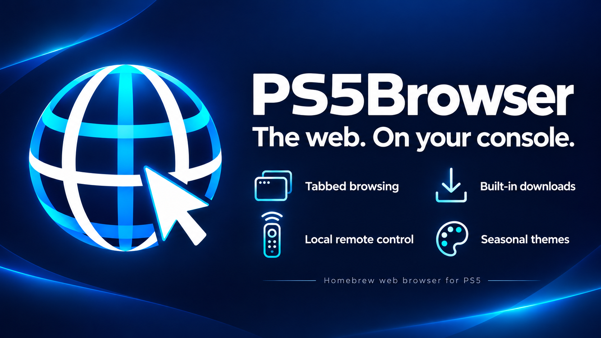

# PS5Browser

A homebrew web browser, download manager and file toolkit for PS5.
Browse on your console, download directly to your storage, extract archives,
convert supported game folders to exFAT images, and manage the app from a phone
or PC on your local network. The browser service runs on the PS5; no PC server
is required.

**[Download the latest native package](https://github.com/Vibe-Code-Jesus/PS5Browser-Releases/releases/latest)**
· [Features](#features) · [Getting started](#getting-started) · [Updates](#updates)

Native title ID: **PPSA99257**. This release follows the original **4.4.25 browser
line**, packaged as a native homebrew app.

## Features

### Browse comfortably on the console

- Tabbed browsing, bookmarks, an address/search bar and desktop-site requests.
- Built-in popup blocking and saved-login/autofill options.
- Classic colors and illustrated seasonal themes, with optional automatic
  seasonal switching.
- A fresh Home screen with the browser toolbar when the native app launches.
  **Reset tabs** provides an escape from a stuck page or CAPTCHA redirect.

### A download manager built into the browser

- Save directly to available internal storage, M.2 or USB destinations.
- Choose a destination for each download, create folders and keep favorites.
- Track download progress and speed while continuing to browse.
- Parallel connections for hosts that support byte ranges, with a single-stream
  fallback where ranges are unavailable.
- Pause, retry and recover supported interrupted downloads, including recovery
  of unfinished files missing from the download list.

### Extract archives and prepare supported files

- ZIP, 7z and RAR extraction directly on the console.
- Split 7z sets and supported multipart RAR volumes; keep all parts together.
- Per-download **Extract** or **Extract & convert** options.
- Convert compatible PS5 game folders or supported archives into exFAT images.
- File management, selected-file operations, moving completed files to external
  storage, and game-name scanning with a rename preview.
- Original files are kept unless a supported removal option is explicitly chosen.

Password-protected archives and 7z BCJ2 are not supported. Direct PKG/FPKG input
is not supported by the exFAT converter in this build.

### TorBox integration

- Add supported file-host URLs or magnet links to your own TorBox account.
- View cloud job status and download ready files through the browser's download
  manager.
- Send supported page links to TorBox without copying them between applications.
- Optional YouTube playback through TorBox, preserving the surrounding page,
  comments and recommendations, with Save and normal-playback fallback options.

TorBox requires your own account and API key. Host availability, preparation
time and supported media formats depend on the provider and console.

### Cloudflare and CAPTCHA compatibility tools

- Site mode, direct-browser handoff and cookie import for supported challenge
  flows.
- Manual retry controls and a way back to Home when a challenge gets stuck.
- These tools assist with website compatibility; they do not guarantee that
  every Cloudflare, Google or other CAPTCHA flow will work.

### Media, background work and rest-mode options

- Playback controls for supported downloaded media.
- Background downloads while browsing and options to extract or convert
  completed files.
- An internal-storage option for work during rest mode, plus controls to delay
  automatic rest while external-drive jobs are running.

Rest-mode behavior depends on firmware and console settings and still needs
physical-console validation for this native preview. USB storage can disconnect,
and deep sleep can make the service unreachable until the console wakes.

### Phone and PC access

Open **Downloads → Phone & PC access** to display a QR code or copy a local link.
Choose **Browser & downloads** for managing browsing and files, or **Console
control** to control the active PS5 browser. Both are intended for your trusted
home network; they are not public internet-access links.

### Updates from inside the browser

The app checks GitHub at startup and every 30 minutes. A newer native package
appears on the main screen. Click **Update via GitHub** to download, verify,
install and restart.

The updater keeps a recovery copy until both the native app and browser core
confirm the new version. It then removes old managed package files and temporary
update downloads. Failed startup triggers rollback; browser data is preserved.

## Getting started

1. Download the **PS5Browser-Native-…-Preview.zip** asset from the
   [latest release](https://github.com/Vibe-Code-Jesus/PS5Browser-Releases/releases/latest).
2. Extract the complete **PPSA99257** folder into your existing homebrew location.
   For a manual upgrade, close the app and replace the contents of that same folder.
3. Keep **eboot.bin**, **sce_sys**, **sce_module**, **assets** and **licenses**
   together. Avoid nesting a second PPSA99257 folder inside the first.
4. Refresh your homebrew library and launch PS5 Browser. Home opens with its
   toolbar; the native backdrop underneath is intentionally black.
5. Keep **/data/ps5browser** when updating. It holds browser settings and other
   persistent browser data.

Use the existing homebrew environment that already launches the app. The browser
core and update helper are included in the package.

### Start browsing and downloading

Enter a website or search in the address bar. File links open the download
dialog, where you choose a destination and supported archive options.
**Downloads → File Management** handles files already on the console.
Configure your own TorBox key in **Download settings → TorBox** to use its
supported cloud features.

For sites needing site mode or a challenge handoff, use the app's **Cloudflare &
captchas** settings and connection diagnostics. Website compatibility depends on
the PS5 browser engine and the site's requirements.

## Updates

**Native .006 and earlier need one manual full-package replacement** to gain
the installer. Later updates use **Update via GitHub**.

The update channel is fixed to **Vibe-Code-Jesus/PS5Browser-Releases**. The app
checks the release's native package version, expected asset name, byte count and
SHA-256. A check alone does not install anything; the user starts installation
with the update button. Offline checks do not prevent normal browsing.

Use the complete native package for this edition. Legacy ELF-only installation
is disabled so an update cannot leave the native app and browser core mismatched.
Keep only one installed PPSA99257 folder on connected homebrew storage so the
updater can identify the correct installation.

## Compatibility and release status

This native preview is available for PS5 testing and ProsperoStore review.
Local build, package validation, update integration, restart-failure rollback
and interruption-recovery checks passed. Actual native restart and storage
behavior still require confirmation on a physical PS5.

JavaScript-heavy sites, DRM and some streaming services may not work. Media
playback depends on the available formats and codecs. Cloudflare/CAPTCHA and
TorBox support vary by site and provider.

## Public downloads and private source

This public repository contains compiled packages, artwork, documentation,
license notices and release automation. Application source and owner development
backups are kept separately and are not uploaded here.

GitHub adds automatic **Source code (zip/tar.gz)** links to releases. Those links
archive this release repository; they do **not** contain the PS5Browser application
source. Download the named **Preview.zip** asset to install the app.

For interruptions that prevent the app from starting, the package includes an
independent recovery helper. See **PREVIEW.txt** inside the package for recovery
instructions and diagnostic log locations.

Not affiliated with Sony Interactive Entertainment.
